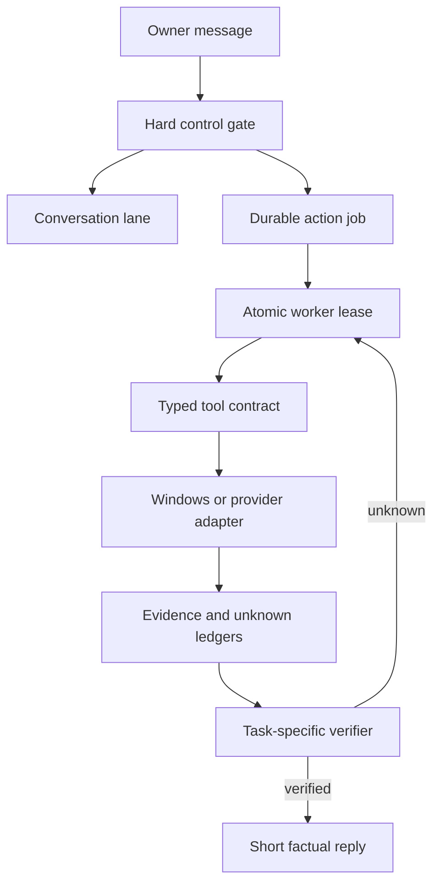

# MYLES Agent Stack Audit

Version reviewed: 10.6.0  
Canonical repository: `JoshuaDuskin/MylesAI`  
Method: complete active-file inventory plus REA contract/workflow comparison

## Finding

The local Qwen model was being asked to compensate for controller defects. It cannot. The observed failures were caused by the stack around the model:

- cancellation ran after desktop parsing, so “quit all queued tasks” could create another action;
- global stop did not clear pending or authentication-blocked work;
- workers did not hold an exclusive completion lease, allowing cancelled work to publish late results;
- pending jobs were not atomically claimed before launch;
- screenshots passed 64-bit Windows handles through untyped `ctypes` calls, producing the argument-overflow error;
- tool outcomes existed mainly as strings and chat summaries instead of canonical typed evidence;
- screenshot bytes could be attached without enforcing the selected model's advertised vision capability;
- the plugin framework had no real providers, so email, health, and home-control claims could only be aspirational;
- the test suite had no real Windows interactive-session acceptance lane.

Version 10.6.0 fixes the first six defects, enforces the vision contract, adds durable agent sessions/plans/context bounds, and makes unsupported providers remain visibly unsupported. It does not claim sentience and does not claim access to Codex's private source, prompts, weights, or service internals.

## REA findings applied

`morluto/rea` is a reverse-engineering toolkit, not a general autonomous-agent runtime. Its useful engineering patterns are now applied to MYLES:

| REA pattern | MYLES 10.6 implementation |
|---|---|
| Contracts separate from providers | Tool schemas stay separate from Windows/provider handlers |
| Deterministic session ownership | Atomic pending-job claim plus worker PID lease |
| Canonical evidence records | SQLite `evidence` ledger records tool, args, outcome, digest, and provenance |
| Explicit unknowns | Failed verification writes an `unknowns` ledger entry |
| Typed limitations/errors | Evidence records preserve outcome kind and capability limitations |
| Cancellation ownership | Global stop revokes every executable queue state and prevents stale completion |
| Bounded output | Tool evidence, arguments, screenshots, and REA output have hard size limits |
| Untrusted target provenance | Web, browser, and REA target output is marked untrusted content |
| Fixture-driven checks | Release suite tests routing, leases, screenshot ABI, evidence, and windowless execution |

REA is also available as an optional read-only capability for owner-authorized local JavaScript/Electron targets. It is pinned to `rea-agents@6.4.0`, runs windowlessly, passes arguments without a shell, blocks protected project paths, and labels all target content as untrusted. It cannot reverse engineer MYLES's Python stack or Codex's hosted private implementation.

## Target architecture

The model proposes actions inside the loop. It is not the scheduler, queue owner, permission system, evidence source, or completion authority.

## Observable Codex-style workflow versus MYLES

This comparison uses externally observable behavior and documented design patterns. It is not a claim about private Codex internals.

| Concern | Competent tool agent | MYLES 10.6 state |
|---|---|---|
| Control | Stop/cancel preempts all semantic routing | Hard gate executes before app/action parsing |
| Planning | Model selects from typed tools | Qwen receives bounded JSON tool schemas |
| Execution | Narrow adapters own side effects | Windows, file, web, Git, shell, browser, and plugin handlers |
| Ownership | One action has one valid runner | Atomic claim plus PID-conditional state updates |
| Observation | Results are structured and attributable | Evidence ledger with provenance and digest |
| Uncertainty | Unknown remains unknown | Unverified outcomes enter an explicit ledger |
| Vision | Images only reach a vision-capable model | Ollama capability probe gates screenshot attachment |
| Completion | Requested outcome needs direct proof | App launch requires matching process/window evidence |
| Conversation | Tool progress is not fabricated prose | Deterministic summaries for verified desktop actions |
| Providers | Installed/authenticated/readiness are separate | Registry is real; absent providers remain absent |
| Safety | Least privilege and protected boundaries | PineTree block and owner authentication gates remain |
| Evaluation | Unit, contract, replay, and live acceptance tests | Static/behavioral suite is broad; live Windows lane remains required |

## Active runtime map

| Layer | Files | Responsibility |
|---|---|---|
| Transport | `index.html`, `dashboard_bridge/dashboard_bridge.py`, `bin/public_gateway_v074.py` | Paired phone UI, authenticated bridge, gateway |
| Controller | `myles_core.py`, `myles_runtime_v9.py` | Hard controls, conversation routing, queue creation, cancellation |
| State | `myles_common.py`, `myles_evidence.py` | SQLite jobs/messages/traces/evidence/unknowns and worker leases |
| Agent loop | `job_worker.py` | Tool selection, retries, observation, completion verification |
| Model | `myles_model_runtime.py` | Ollama discovery, Qwen chat, capability probe, recovery |
| Tools | `myles_tools.py`, `myles_windows.py` | Files, web, Git, shell, browser, windows, input, screenshots |
| Capabilities | `myles_capabilities.py`, `capabilities/rea_analysis.py` | Cached plugin registry and optional REA analysis adapter |
| Supervision | `bin/runtime_supervisor_v074.py`, `bin/ensure_myles_runtime.py` | One hidden canonical process tree and recovery |
| Performance | `bin/game_mode_watch.py` | Heavy-service coordination without taskbar manipulation |
| Quant | `quant/*.mjs` | Separate market research/paper/execution subsystem |
| Release | `UPDATE_TOWER.ps1`, `self_test.py`, workflows | Recoverable install and regression gate |

Everything under `legacy_archive/` is historical and must not be imported, launched, or treated as runtime truth.

## What 10.6 changes

1. Global stop is a deterministic command even when embedded in a correction.
2. Global stop terminates running workers and cancels pending, recovering, and blocked jobs.
3. Job launch uses an atomic `pending -> launching` claim.
4. Worker state changes require the current PID lease; revoked workers cannot finish or fail a cancelled job.
5. Win32 GDI screenshot functions declare pointer-safe argument and return types.
6. Every tool attempt writes typed, bounded evidence with provenance and a SHA-256 digest.
7. Failed outcome verification records an explicit unknown.
8. Screenshot images are attached only if Ollama advertises vision and the capture is within the configured budget.
9. REA analysis is pinned, read-only, windowless, shell-free, bounded, protected-path aware, and untrusted by default.
10. Agent sessions, short plans, tool-call lifecycle records, context compaction, and authoritative live session metadata are persisted per job.

## Deeper black-box reconstruction

The REA CLI was actually exercised against the repository's six-file JavaScript/Quant artifact. It returned a partial JavaScript application graph, artifact digest, graph node/edge identities, semantic relation families, coverage limitations, and explicit unknowns. It then stopped before runtime-backed analysis because the host did not provide the process-ownership provider in a form REA could use. That is a useful result: the analyzer did not promote static syntax into runtime truth.

The same separation now exists in MYLES:

- `agent_sessions` identifies one durable owner goal and model session;
- `agent_plans` stores at most 20 bounded steps with revision and status;
- `tool_calls` records requested/running/succeeded/failed/cancelled attempts, fingerprints, result bounds, and evidence IDs;
- `evidence` distinguishes runtime observation, local execution, external source, and shipped-artifact authority;
- `unknowns` remains open until qualifying evidence resolves it;
- `compact_messages` preserves the system contract and newest working turns within a context budget;
- the worker receives a live session/plan/evidence/unknown snapshot on every durable job.

This is the important Codex-like behavior to reproduce: the model can propose, but the runtime owns the session, tool lifecycle, context budget, evidence, cancellation, and completion decision.

## Honest remaining gaps

- Qwen 9B will not match a frontier hosted model's planning quality. Controller correctness can prevent lies and loops but cannot manufacture missing reasoning capacity.
- MYLES has screenshots, window metadata, mouse, and keyboard, but no accessibility/UI Automation tree yet. Coordinates remain less reliable than semantic controls.
- Email, calendar, health, Ring, and smart-home providers are not installed. Each needs an adapter, scoped OAuth/device credentials, confirmation rules, and audit logging.
- Long-term memory is bounded SQLite history, not semantic memory with retention/deletion controls.
- Windows desktop acceptance still needs to run on the actual interactive tower; Linux CI cannot prove focus, SendInput, Xbox availability, or GPU-session behavior.
- Medicine manufacture or autonomous dosing is outside the safe capability boundary. MYLES may support evidence-based tracking, reminders, data analysis, and clinician-reviewed plans.
- Trading execution must remain behind explicit account, risk, amount, and confirmation controls; conversational confidence is never trade evidence.

## Release acceptance matrix

| Scenario | Required result |
|---|---|
| “Open Xbox” | Generic launcher executes immediately and replies only after visible-window verification |
| “Stop” | Current worker loses its lease and cannot publish afterward |
| “Stop all tasks and clear the queue” | Running, queued, recovering, and blocked work becomes cancelled |
| Late cancelled worker result | Discarded because PID lease no longer matches |
| Desktop screenshot | No 64-bit handle overflow; image attached only with advertised vision |
| Tool failure | Typed evidence persists; unverifiable requested effect remains unknown |
| Console behavior | Runtime, tools, REA, and guardian use windowless process flags |
| Unsupported provider | Reported missing; no promise or simulated completion |
| Release | Compile pass and the complete `self_test.py` suite pass twice |

## Tower-only validation still required after installation

The installer must run its normal service checks, then the interactive Windows lane must verify: Xbox launch, Start-menu closure after launch, screenshot capture, one mouse/keyboard observe-act-observe cycle, stop-all during active work, no late replies from cancelled jobs, and no visible console flashes during phone chat. Those checks require the owner's real signed-in Windows desktop and cannot be truthfully certified in this repository workspace.
