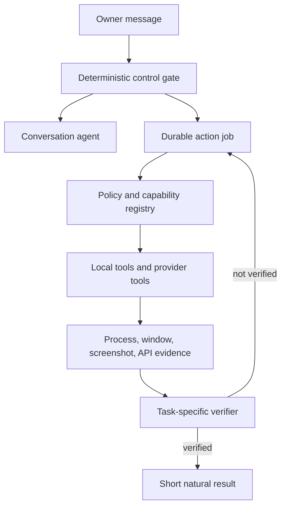

# MYLES Agent Stack Audit

Version reviewed: 10.4.1  
Canonical repository: `JoshuaDuskin/MylesAI`

## Bottom line

The installed Qwen model is not a self-contained desktop agent. A model supplies language, visual interpretation, and tool-call selection. The runtime must supply authoritative state, safe tools, cancellation, provider authentication, evidence, retries, and a truthful completion gate.

MYLES had most of those pieces, but they were disconnected:

- chat and job execution used separate tool sets;
- app launch was hard-coded for Fortnite instead of being a general capability;
- a blocking Fortnite shortcut raced newer owner messages;
- the verifier accepted broad activity instead of evidence for the requested outcome;
- screenshot bytes reached the model, but model vision/tool capability was inferred from its name rather than checked;
- a plugin loader existed, but no email, health, Ring, or home provider was installed;
- internal worker/process text could be summarized into owner-facing nonsense.

Version 10.4.1 repairs the controller path for generic Windows app launches, cancellation/replacement, model capability truth, launch-specific evidence, deterministic owner results, and public capability observability. Provider integrations still require a real provider module plus owner authentication; the runtime must never claim otherwise.

## The architecture MYLES needs

The model is inside the conversation/action loops. It is not the scheduler, source of truth, permission system, or completion verifier.

## Codex-style infrastructure versus MYLES

| Concern | Competent agent infrastructure | MYLES before 10.4 | MYLES 10.4 state |
|---|---|---|---|
| Intent | Deterministic controls surround model routing | Rules and model routing existed, but special paths raced | Short app actions and replacement are deterministic |
| Tools | Typed inventory with real handlers | Rich worker tools, tiny chat tools, no generic launcher | Generic verified Windows app launcher added |
| Vision | Image-capable model contract plus screenshot loop | Screenshots were attached without checking the model contract | Ollama tool/vision capabilities are probed and observable |
| Action loop | Observe → act → observe → verify | Prompt requested the loop, but broad evidence could pass | Launch completion requires matching process/window evidence |
| Cancellation | Newer owner intent invalidates stale work | Blocking Fortnite call could spawn an old fallback later | Launch occurs in one cancellable worker; “instead” replaces |
| Results | Structured evidence converted deterministically | Model could turn PID/log text into a chat answer | Verified launch/close markers become short fixed results |
| Providers | Explicit installed/authenticated/readiness states | Loader only; no provider modules installed | Still truthful: no provider exists until installed/configured |
| Memory | Bounded chat history plus durable structured state | SQLite history/jobs exist; no semantic long-term memory | Honest persistent history; semantic memory remains future work |
| Safety | Least privilege, confirmation gates, scoped credentials | App-level guards and owner gates | Preserved; PineTree remains blocked |

## End-to-end runtime map

1. `dashboard_bridge/dashboard_bridge.py` accepts the paired phone request and forwards it to the localhost core.
2. `myles_core.py` records the message and applies deterministic controls before any language-model decision.
3. Conversation stays in `model_chat`; actual computer work becomes a durable job in SQLite.
4. `job_worker.py` owns the action loop and typed tool catalog.
5. `myles_windows.py`, `myles_tools.py`, or an installed capability provider performs the action.
6. Tool traces provide evidence. A request-specific completion gate rejects unrelated activity.
7. Only verified output becomes an owner-facing result.
8. `bin/runtime_supervisor_v074.py` and `bin/ensure_myles_runtime.py` keep one hidden canonical runtime alive.

## Active source file map

| File | Responsibility | Audit disposition |
|---|---|---|
| `myles_core.py` | HTTP core, conversation, intent, jobs, cancellation | Active; generic direct-action controller repaired |
| `job_worker.py` | Durable agent loop, tool schema, retries, verification | Active; launch tool and exact evidence added |
| `myles_tools.py` | Files, shell, web, Git, browser, desktop primitives | Active; broad and useful, but provider-neutral |
| `myles_windows.py` | Shared verified Windows actions | Active; generalized beyond Fortnite |
| `myles_model_runtime.py` | Ollama discovery/chat/recovery and optional Jev | Active; model capability contract now probed |
| `myles_runtime_v9.py` | Deterministic language/control helpers and tool outcomes | Active; named current-task stops and unverified outcomes fixed |
| `myles_common.py` | Config, SQLite state, messages, jobs, traces | Active source of runtime truth |
| `myles_capabilities.py` | Provider plugin discovery/execution/background hooks | Active framework; zero provider modules currently installed |
| `myles_quick.py` | Fast read-only public lookups | Active; avoids turning simple questions into jobs |
| `myles_console.py` | Compatibility console entry | Active compatibility layer |
| `configure_telegram.py` | Optional Telegram setup | Active optional channel setup |
| `restart_helper.py` | Retired restart compatibility shim | Kept for compatibility, not runtime ownership |
| `runtime_supervisor.py` | Supervisor compatibility entry | Delegates to canonical supervisor |
| `self_test.py` | Compile/static/behavioral regression suite | Active release gate, expanded for 10.4 |
| `setup_myles.py` | Initial local installation | Active installer |

## Runtime, bridge, and dashboard files

| File | Responsibility | Audit disposition |
|---|---|---|
| `bin/runtime_supervisor_v074.py` | Owns and monitors core, bridge, gateway, Quant workers | Canonical process owner |
| `bin/ensure_myles_runtime.py` | Hidden logon/recovery guardian | Prevents console popups and restores runtime |
| `bin/game_mode_watch.py` | Gaming/load mode coordination | Active; does not remove direct owner control |
| `bin/public_gateway_v074.py` | Public authenticated gateway | Active boundary |
| `bin/myles_console_v074.py` | Local owner console | Optional visible client |
| `dashboard_bridge/dashboard_bridge.py` | Phone pairing, auth, chat/status bridge | Active phone transport |
| `dashboard_bridge/start_bridge.ps1` | Manual bridge helper | Maintenance helper |
| `index.html` | Canonical phone dashboard | Active UI |
| `bridge.json` | Public bridge discovery metadata | Active sanitized metadata |
| `.github/workflows/pages.yml` | GitHub Pages deployment | Active CI |
| `.github/workflows/validate-runtime.yml` | Runtime validation | Active CI |

## Installation and operations files

| File | Responsibility | Audit disposition |
|---|---|---|
| `START_MYLESAI.cmd` | Canonical start entry | Active, hidden-supervisor path |
| `STOP_MYLES.cmd` | Scoped runtime stop | Active |
| `UPDATE_TOWER.cmd` | User-facing updater wrapper | Active |
| `UPDATE_TOWER.ps1` | Backup, canonical sync, preserve, restart, verify | Active; supports non-Git/broken-Git recovery |
| `FINALIZE_TOWER.ps1` | Historical finalization helper | Maintenance only |
| `OPEN_LAST_RESULT.cmd` | Opens last saved result | Convenience helper |
| `.gitignore` | Excludes secrets/runtime/generated data | Correctly scoped |
| `github-cli/config.yml` | Bundled CLI preferences | Contains no credential |
| `github-cli/hosts.yml` | Bundled host identity metadata | Contains no token |

## Quant files

`quant/quant_service.mjs`, `copy_trader_service.mjs`, `gmx_live.mjs`, and `gmx_module_probe.mjs` implement market research/paper/execution support; `package.json` and `package-lock.json` pin dependencies; `start_quant.ps1` and `repair_quant_runtime.ps1` operate the service; `quant/README.md` documents it. These remain separate from conversational/desktop agency and were not repurposed. Live financial actions must retain explicit risk and authorization controls.

## Documentation and policy files

`README.md`, `RUNTIME_ARCHITECTURE.md`, `CONSOLIDATION.md`, `OWNER_RULES.md`, and this audit describe the canonical repository, process ownership, safety boundary, and update procedure. `capabilities/README.txt` defines the provider plugin ABI but is not itself a capability.

## Legacy archive inventory

Everything below `legacy_archive/` is historical and must not be imported, launched, published, or treated as current source. The archive contains old M83 notes; dashboard variants (`M83-dashboard`, `Myles-AI-Dashboard`, `Myles-ControlCenter`, `Myles-Ecosystem`, `MylesDashboard`, `MylesLiveStatus`, `my-dashboard`, `myles-dashboard`, `progress-dashboard`); an obsolete `tower-bridge`; and the previous `trading-dashboard` implementation. Its HTML, JavaScript, package files, Git hooks, bridge metadata, and recovery notes are rollback/history only.

## What works without paid inference

- local conversational inference through Ollama/Qwen;
- model-selected typed tools;
- screenshot-to-model visual reasoning when Ollama advertises vision;
- mouse, keyboard, window focus, app close, and generic app launch;
- file/code/app building, PowerShell, Git, public web research, downloads, and persistent browser automation;
- durable task state, cancellation, retries, evidence, and recovery.

## What needs a real provider or stronger guardrail

| Goal | Required addition |
|---|---|
| Send/read email | Gmail or Microsoft Graph provider, OAuth scopes, recipient confirmation and send audit |
| Ring/home control | Provider module, device auth, device allowlist, risky-action confirmation |
| Weight management | Health-data import, consent, provenance, trend tools, clinician-safe guidance boundaries |
| Medication support | Scheduling/reminders and verified device integration only; never autonomous drug manufacture or dosing |
| Strong long-term memory | Local embeddings/index, retention controls, correction/deletion UI, provenance |
| Higher reliability | Scenario evaluation set, visual replay tests, latency budgets, per-tool permission policy |

MYLES cannot literally be made sentient. It can be made situationally aware by grounding each turn in current conversation, task state, screen evidence, installed capability state, and verified tool results. That is the engineering target.

## Release acceptance criteria

- A simple `Open Xbox` command bypasses the planner and uses `desktop_launch_app`.
- `Open Xbox app instead` cancels the stale active action before starting Xbox.
- No launch completes without a matching process or visible window.
- `Stop the current Fortnite task` is a deterministic stop command.
- The health endpoint reports the selected model's advertised tool and vision support.
- The owner sees `Xbox is open`, not worker PIDs, planner prose, or a promised summary.
- Missing email/health/home providers are reported as missing, never hallucinated as installed.
- The full self-test suite passes before deployment.
